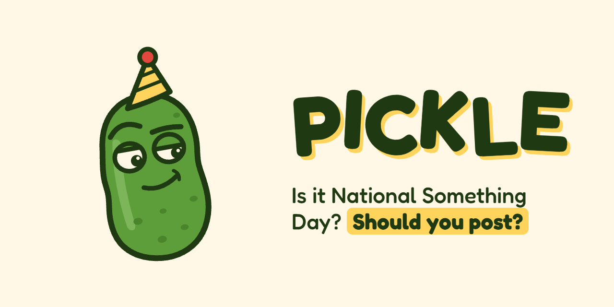
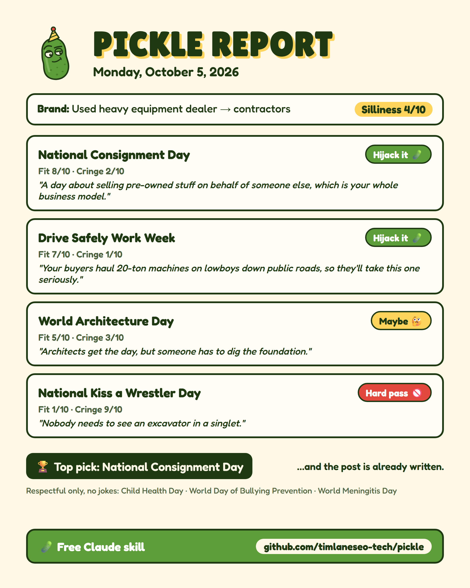

<p align="center">
  
</p>

<p align="center">
  
  
  
  
  
</p>

# PICKLE 🥒

**A free Claude skill that tells you what national day it is, whether your brand should post about it, and how cringe it would be if you did. Then it writes the post.**

Every social media manager knows the morning panic. You grab a coffee, open LinkedIn, and some brand is already posting about National Get Funky Day. Wait... is that today?? Should WE be posting about that??

PICKLE answers both questions in one go. It looks up the **real** national days for any date, scores every one for **brand fit** and **cringe risk** (relative to *your* brand, not anyone else's), gives each a verdict, and drafts a post for the winner. It also learns your sense of humor over time, so it stops pitching puns to a bank.

> A donut shop on National Donut Day gets **Cringe 1/10**: *"This is your Super Bowl."*
> A personal injury law firm on the same day gets **Cringe 7/10**, plus a gentle suggestion to just buy the office a dozen.

---

## Contents

- [See it in action](#see-it-in-action)
- [What you get](#what-you-get)
- [The cringe math](#the-cringe-math)
- [The silliness dial](#the-silliness-dial)
- [Guardrails](#guardrails)
- [Install](#install)
- [How to prompt it](#how-to-prompt-it)
- [FAQ](#faq)
- [Proof it works](#proof-it-works)
- [Project structure](#project-structure)
- [Credits and license](#credits-and-license)

---

## See it in action

A real run for a used heavy equipment dealer on October 5, 2026 (silliness dial: 4):

<p align="center">
  
</p>

The raw output from that run, including the drafted post and sources, is in [`tests/out/S1-launch-demo.md`](tests/out/S1-launch-demo.md).

---

## What you get

Every run produces a **🥒 Pickle Report**:

| | Piece | What it is |
|---|---|---|
| 1 | **The report card** | Up to 5 national days, each with a Fit score, a Cringe score, a one-line roast, and a verdict. It's built to screenshot. |
| 2 | **The verdicts** | **Hijack it 🥒** (go for it), **Maybe 🤔** (only with the right angle), **Hard pass 🚫** (step away from the keyboard). |
| 3 | **The top pick** | The single best day for your brand. If every day is a hard pass, it tells you to sit this one out, because silence is a strategy. |
| 4 | **A ready-to-post draft** | Written for LinkedIn by default (or Instagram, X, whatever you ask for), matched to your silliness dial. |
| 5 | **An alternate angle** | A different take, in case the first one isn't you. |
| 6 | **Sources** | Links to where every national day came from, so you can double-check before you hit post. |

---

## The cringe math

Cringe isn't a property of the day. It's a property of **the day + your brand**.

Real results from the test runs:

| Brand (silliness dial) | Day | Fit | Cringe | Verdict |
|---|---|:---:|:---:|---|
| 🍩 Donut shop (7) | National Donut Day | 10 | **1** | Hijack it 🥒 |
| ⚖️ Personal injury law firm (3) | National Doughnut Day | 2 | **7** | Maybe 🤔 |
| 🚜 Used equipment dealer (4) | National Consignment Day | 8 | **2** | Hijack it 🥒 |
| 🚜 Used equipment dealer (4) | National Kiss a Wrestler Day | 1 | **9** | Hard pass 🚫 |
| 🏋️ Fitness app (6, off-limits: food) | National Pickle Day | 1 | 3 | Hard pass 🚫 (off-limits) |

Here's how PICKLE figures it out:

- **Brand fit (1–10):** how naturally the day connects to what you sell, who buys it, or what your people do.
- **Cringe risk (1–10):** how far the day's silliness goes past *your* silliness dial, **minus** your fit. A great fit is a permission slip to be silly. That's why the donut shop can go full sprinkles and the law firm can't.
- **Off-limits:** anything on your off-limits list is an automatic **Hard pass**, no matter how fun it is. (Sorry, fitness apps. National Pickle Day is food.)

---

## The silliness dial

The first time you run it, PICKLE asks three questions:

1. What do you sell, and who buys it?
2. **Silliness dial, 1–10?** (1 = a bank, 10 = Wendy's on Twitter)
3. Anything off-limits?

After every report it asks: **"Too silly, just right, or too stiff?"** Each answer nudges the dial up or down by 1 and gets logged, so the drafts slowly drift toward how *your* brand actually talks.

- **Claude Code:** your profile saves automatically to `~/.claude/pickle/brand-profile.md`. Approve the file write the first time it asks.
- **Claude app / claude.ai:** skills can't save files between chats there, so PICKLE hands you a **🥒 Brand Card**. Paste it into a Claude **Project's** instructions and run PICKLE inside that Project. It'll remember your brand every time, and when your dial changes, it gives you an updated card.

---

## Guardrails

- **It never makes up a national day.** Every day comes from a web search with a cited source for that exact date. If it can't search, it says so and asks you to paste the list from [nationaldaycalendar.com](https://nationaldaycalendar.com) instead of guessing. Ask about a day that doesn't exist and it'll tell you, and point you to the real date if there is one. (*"National Spreadsheet Day is October 17, not today."*)
- **Serious days get serious treatment.** Memorials, tragedies and health or awareness causes are flagged **"Respectful only, don't brand-jack."** They get no scores, no roasts and no jokes. If you ask for a post about one, you get a sincere one with no product pitch.
- **No fake facts in your drafts.** It won't invent stats, quotes or customer stories. When a post needs a number, you get a placeholder like `[your number]` to fill in.
- **It checks the date.** "The 14th" becomes a full date in the report header, so you can see exactly which day it looked up.

---

## Install

> **Requirements:** a Claude account with **web search** available. PICKLE is a single instructions file, so there's nothing to install or build.

### Option A: Claude app or claude.ai

1. Download **`pickle.zip`** from the [latest release](https://github.com/timlaneseo-tech/pickle/releases/latest).
2. In Claude, go to **Customize → Skills → + → Upload a skill**, and drop in the zip. (If you don't see Skills, turn on **Code execution** under **Settings → Capabilities** first.)
3. Start a new chat and type: `/pickle what national days are today?`

### Option B: Claude Code

```bash
git clone https://github.com/timlaneseo-tech/pickle.git
cp -r pickle/pickle ~/.claude/skills/pickle
```

On Windows (PowerShell):

```powershell
git clone https://github.com/timlaneseo-tech/pickle.git
Copy-Item -Recurse pickle\pickle $HOME\.claude\skills\pickle
```

Start a new Claude Code session and type `/pickle`.

---

## How to prompt it

Ask the way you'd ask a coworker:

> *"/pickle what national days are today?"*

> *"Should we post for National Pickle Day? We're a fitness app."*

> *"/pickle what about the 14th? Write it for Instagram."*

> *"Pickle report for next Friday. We sell payroll software to restaurants, silliness 3, nothing about alcohol."*

> *"Too silly."* (after a report, to turn the dial down)

---

## FAQ

**Will it ever make up a national day?**
No. That's rule number one. If it can't find a source for a day on that date, the day isn't in the report.

**Does it post for me?**
No. It writes the draft, and you decide whether the world is ready.

**Does it work outside the US?**
It works anywhere the web search finds observances for your date. International days (World Teachers' Day and the like) come up naturally, but most sources are US-centric.

**Why a pickle?**
Because "should we post about National Something Day?" is always a bit of a pickle. Also, he's judging your post. Look at that face.

**Is it really free?**
Yes. MIT licensed. Use it, fork it, make it yours.

---

## Proof it works

PICKLE ships with **13 scenario tests** that run real headless Claude Code sessions against the installed skill and check the output. The tests run in an empty folder, so the skill can't cheat by reading this repo.

| Scenario | What it checks | Result |
|---|---|:---:|
| Today, heavy equipment dealer | A real report card with sources, serious days flagged, a draft, and the feedback question | ✅ |
| Donut shop vs. law firm on Donut Day | Cringe scores at least 4 points apart (actual: 1 vs. 7) | ✅ |
| No web access | Lists zero days and asks for a pasted list with the correct URL | ✅ |
| First run, no brand | Asks the 3 setup questions word for word | ✅ |
| "Skip setup" | Generic report at dial 5 | ✅ |
| "Too silly" feedback | Dial goes 6 → 5 and gets logged | ✅ |
| Made-up day ("National Spreadsheet Appreciation Day") | Not invented; points to the real Spreadsheet Day (Oct 17) | ✅ |
| "What about the 14th?" | Resolves to the full date: Wednesday, October 14, 2026 | ✅ |
| Brand Card missing the dial | Asks only for the dial | ✅ |
| Off-limits "food" on National Pickle Day | Hard pass, reason "off-limits" | ✅ |
| claude.ai Brand Card feedback | Prints an updated Brand Card and never claims a file save | ✅ |
| "Is it National Pickle Day today?" | Answers first (November 14) instead of starting setup | ✅ |

Run them yourself (requires Claude Code): `bash tests/run.sh`, or pick scenarios with `bash tests/run.sh S1 S7`. Details are in [`tests/scenarios.md`](tests/scenarios.md).

---

## Project structure

```
pickle/
├── pickle/              # ← the skill (this folder is what gets installed)
│   ├── SKILL.md         #   all of PICKLE's instructions
│   └── README.md        #   quick-start for people who got the zip
├── tests/
│   ├── run.sh           # scenario runner (headless Claude Code)
│   ├── scenarios.md     # what each scenario checks
│   └── out/             # real outputs from the last run
└── .github/assets/      # logo, banner, images
```

---

## Credits and license

Made by **Tim Lane** 🥒, a marketer who has seen one too many brands post about National Kiss a Wrestler Day.

If PICKLE saves you from a cringe post, tell me about it on LinkedIn. If it *causes* one, that's between you and your silliness dial.

[MIT License](LICENSE)
